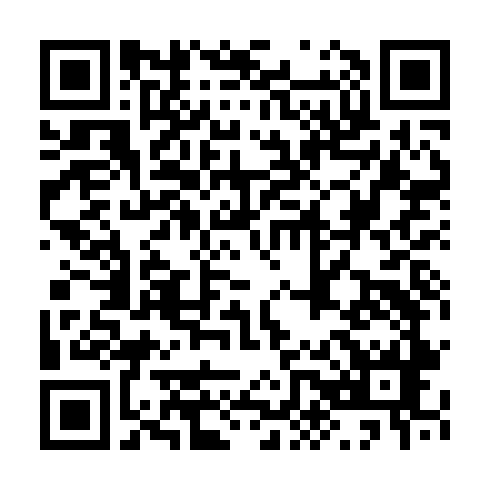
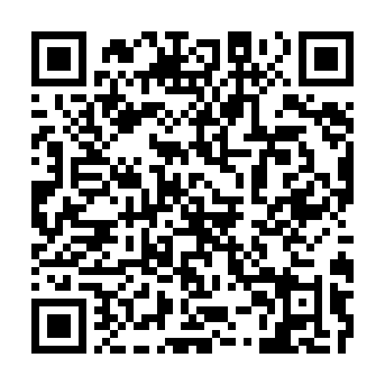
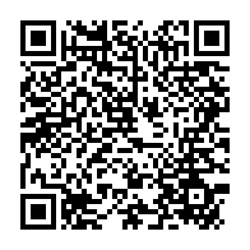

# Álvaro Carvajal · Portafolio de desarrollo

Estudiante TNS Analista Programador. Proyectos personales y académicos en C#, ASP.NET Core, Java, Android, Python y C para Nintendo 3DS.

## Aplicaciones

- **[DrogueriaDASchiguayante](https://github.com/AlvaroACG/DrogueriaDASchiguayante)**: Gestión de inventario por lotes, trazabilidad, FEFO, roles y programas UAPO/Paternidad. Versión 3.1 de demostración sin datos operativos.
- **[CartonGO](https://github.com/AlvaroACG/CartonGO)**: Aplicación Android para cartas, mazos, comunidad y herramientas de juego.
- **[CartonBrillante](https://github.com/AlvaroACG/CartonBrillante)**: Antecedente académico Android de CartonGO.
- **[PatitasAgenda](https://github.com/AlvaroACG/PatitasAgenda)**: Agenda Android para cuidados de mascotas, recordatorios y comunidad.
- **[Nintendo-3DS-IA](https://github.com/AlvaroACG/Nintendo-3DS-IA)**: Cliente homebrew de Gemini con voz local y conversaciones; incluye QR CIA.
- **[3DS-Multiherramienta](https://github.com/AlvaroACG/3DS-Multiherramienta)**: Prototipo homebrew de diagnóstico y lectura NFC; incluye QR CIA.
- **[Tamagotchi-3DS](https://github.com/AlvaroACG/Portafolio/tree/main/proyectos/Tamagotchi-3DS)**: Mascota virtual para 3DS; incluye QR CIA y datos SD adicionales.
- **[Linux-2DS-XL](https://github.com/AlvaroACG/Linux-2DS-XL)**: Scripts propios de preparación y transferencia. Sin firmware ni imágenes de terceros.
- **[WoW-3DS](https://github.com/AlvaroACG/Portafolio/tree/main/proyectos/WoW-3DS)**: Scripts propios de preparación de archivos. Sin cliente ni archivos de juego de terceros.
- **[Ejercicios-CSharp](https://github.com/AlvaroACG/Ejercicios-CSharp)**: Ocho ejercicios de ASP.NET Core, EF Core, JWT, SignalR y webhooks.
- **[Ejercicios-Java](https://github.com/AlvaroACG/Ejercicios-Java)**: Tres ejercicios Java/NetBeans.

## Proyecto web existente

- [Venta de huevos](https://github.com/AlvaroACG/PaginaVentadeHuevos)

## Acerca de estas publicaciones

Las copias públicas omiten bases de datos de trabajo, contraseñas, configuraciones personales y archivos de juegos/firmware ajenos. Los requisitos y límites están descritos en cada repositorio. Los proyectos académicos muestran el proceso de aprendizaje; no todos están listos para producción.

Los repositorios son públicos para revisión profesional. Las licencias expresas de cada proyecto y componente se conservan; no se transfiere la autoría por publicar el código.

## Instaladores 3DS y QR

[Descargas CIA, 3DSX y paquetes SD](descargas/) · [Imágenes QR](qr/)

### Nintendo-3DS-IA

[Descargar CIA](https://raw.githubusercontent.com/AlvaroACG/Portafolio/main/descargas/Nintendo3DSIA.cia)

### 3DS-Multiherramienta

[Descargar CIA](https://raw.githubusercontent.com/AlvaroACG/Portafolio/main/descargas/3DSMultiherramienta.cia)

### Tamagotchi-3DS

[Descargar CIA](https://raw.githubusercontent.com/AlvaroACG/Portafolio/main/descargas/TamaConnectionV2.cia)

Los QR descargan solo el CIA mediante FBI. Nintendo 3DS IA y Tamagotchi necesitan además copiar los datos del paquete SD correspondiente. Las instrucciones están en sus README. No se ha realizado una nueva prueba física de instalación en la consola.
